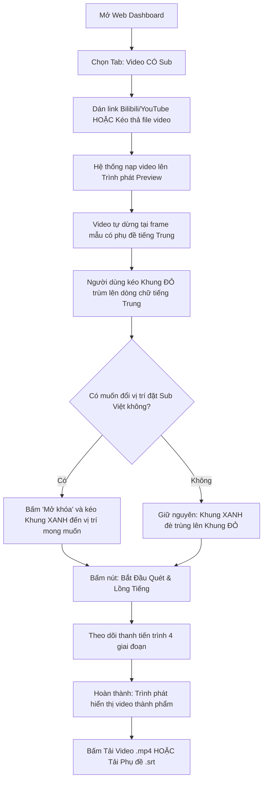
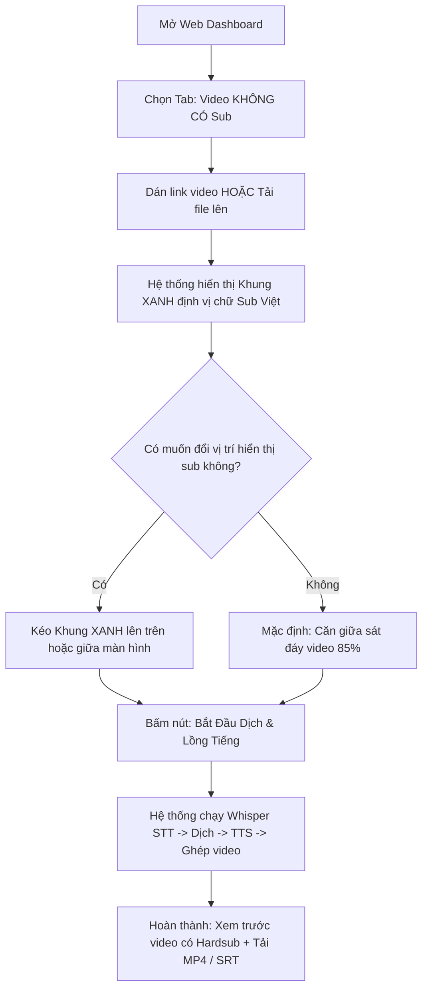
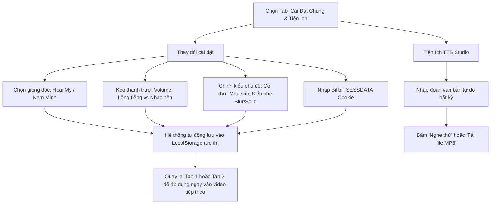

# VS-005 User Flows - Subtitle OCR, Masking & Multi-Tab Workspace

Owner: Design / UX  
Status: Draft / Approved for Implementation  
Slice ID: `VS-005`

## 1. User Flow 1: Xử lý Video CÓ Sub (OCR Subtitle Tracking & Masking)

## 2. User Flow 2: Xử lý Video KHÔNG CÓ Sub (Whisper Audio STT)

## 3. User Flow 3: Quản trị Cấu hình dùng chung & Tiện ích TTS (Tab 3)

