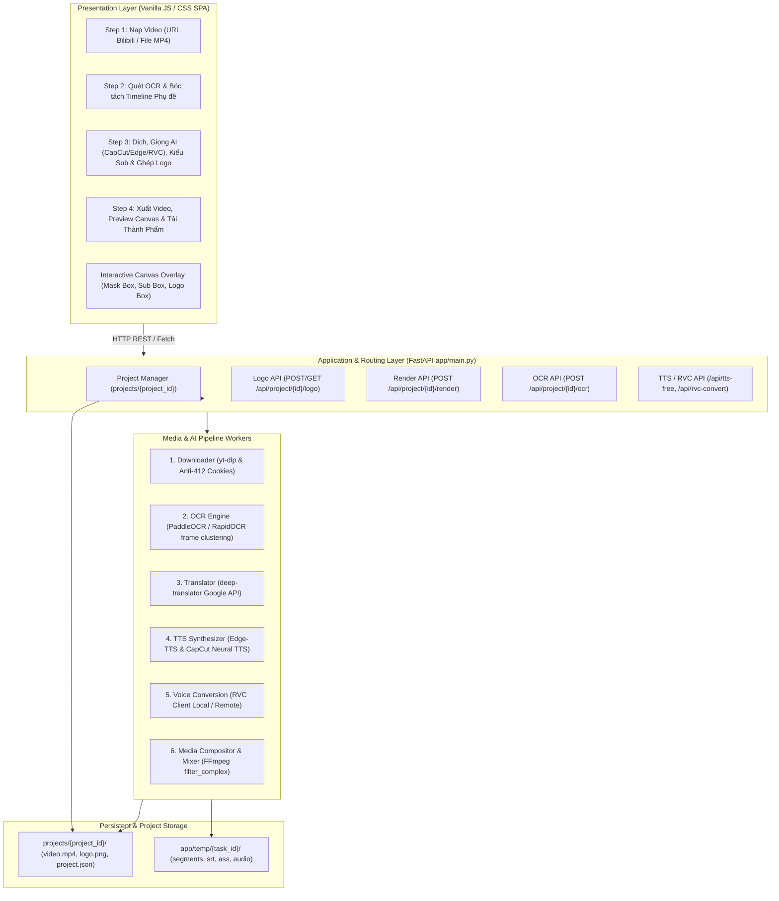

# System Architecture - Kiến trúc hệ thống AI Video Dubber Studio

Owner: TechLead  
Status: Active / Master Architecture  
Scope: Toàn bộ hệ thống tool-translate (Backend FastAPI, Frontend Studio, Media Processing & AI Pipeline)

---

## 1. Tổng quan kiến trúc hệ thống

Hệ thống được thiết kế theo mô hình **Monolith Modular**, kết hợp FastAPI backend phục vụ API RESTful và static frontend SPA, cùng hệ thống worker pipeline điều khiển các công cụ AI xử lý đa phương tiện cục bộ (FFmpeg, Whisper, PaddleOCR/RapidOCR, CapCut/Edge-TTS, RVC).



---

## 2. Các tầng thành phần (Layer Breakdown)

### 2.1. Presentation Layer (`app/static/`)
- Giao diện người dùng Single Page Application (SPA) tối ưu trải nghiệm biên tập video đa bước:
  - **Step 1:** Nạp video gốc qua URL Bilibili/YouTube hoặc tải file MP4 trực tiếp; cấu hình cookie/SESSDATA chống chặn 412.
  - **Step 2:** Quét OCR tự động phát hiện vùng phụ đề cũ, gom cụm frame trùng lặp và trích xuất danh sách câu thoại kèm timestamp.
  - **Step 3:** Bảng biên tập bản dịch song ngữ; tùy biến kiểu phụ đề CapCut (Font, cỡ chữ, màu chữ, viền shadow); chọn giọng đọc AI (CapCut Neural TTS, Edge-TTS) và chuyển đổi giọng RVC; công cụ ghép Logo/Watermark với canvas kéo thả, co giãn 8 anchor points, phím tắt xóa/reset và tùy chỉnh độ mờ opacity.
  - **Step 4:** Render video thành phẩm, hiển thị preview thời gian thực và cung cấp nút tải video MP4, audio MP3, phụ đề rời `.srt`.

### 2.2. API & Routing Layer (`app/main.py`)
- Framework: FastAPI chạy trên máy chủ Uvicorn ASGI (Port 8080).
- Quản lý cấu trúc dự án độc lập theo định danh `project_id` dưới thư mục `projects/{project_id}/`.
- Cung cấp toàn diện 22 endpoints (`API-001` đến `API-022`) bao gồm:
  - Nhóm Quản lý dự án: Tạo mới, mở danh sách, lưu trạng thái, đổi tên dự án.
  - Nhóm OCR & Trích xuất phụ đề: Bóc tách text, đồng bộ timeline segments.
  - Nhóm Giọng đọc & RVC: Đọc thử câu đơn qua CapCut/Edge-TTS, chuyển giọng RVC.
  - Nhóm Quản lý Logo: Upload logo dự án (`POST /api/project/{id}/logo`), lấy thông tin logo (`GET /api/project/{id}/logo`).
  - Nhóm Render & Xuất bản: Nhận toàn bộ thông số (mask_box, sub_style, logo_config, audio_levels) và kích hoạt pipeline xử lý FFmpeg bất đồng bộ.

### 2.3. Pipeline & Worker Layer
- **Downloader (`app/downloader.py`):** Tự động phát hiện và sinh cookie Netscape kèm `buvid3/buvid4` chống lỗi HTTP 412 của Bilibili.
- **OCR Engine (`app/ocr_detector.py`):** Hỗ trợ chuyển đổi linh hoạt giữa PaddleOCR và RapidOCR, thuật toán gom cụm frame dựa trên khoảng cách Levenshtein >= 85% để tạo segments phụ đề ổn định.
- **Transcriber & Translator (`app/translator.py`):** Whisper STT nhận dạng âm thanh cho video không có phụ đề sẵn; Google Translate dịch câu thoại sang tiếng Việt tự nhiên.
- **TTS Synthesizer (`app/tts.py` & `app/capcut_tts.py`):**
  - Edge-TTS: Giọng đọc tiếng Việt Neural (`vi-VN-HoaiMyNeural`, `vi-VN-NamMinhNeural`).
  - CapCut TTS: Giọng đọc truyền cảm tự nhiên đa dạng (`BV001_streaming`, `vi_female_huong`,...).
- **RVC Voice Conversion (`app/rvc_client.py`):** Chuyển đổi âm sắc giọng đọc sau TTS bằng mô hình RVC với cấu hình độ dịch tone (`f0_up_key`), tỷ lệ trích xuất đặc trưng (`index_rate`) và bán kính lọc (`filter_radius`).
- **Media Compositor & Mixer (`app/merger.py`):**
  - Tích hợp chuỗi filter complex đồng bộ:
    1. **Che sub cũ:** Dùng bộ lọc `delogo` hoặc `boxblur` theo tọa độ Khung Che đã chuẩn hóa.
    2. **Ghép Logo / Watermark:** Căn chỉnh tọa độ x, y từ tỷ lệ `%` sang pixel thực `(W_v * x / 100)`; điều chỉnh độ mờ bằng `format=rgba,colorchannelmixer=aa={opacity}`; ghép đè lên luồng video bằng `overlay=x:y:eval=init`.
    3. **Hardsub:** In phụ đề chuẩn ASS với phong cách CapCut (màu viền, cỡ chữ, vị trí) không bị lỗi font tiếng Việt.
    4. **Audio Mixing:** Bù trễ thời gian bằng `adelay`, trộn các luồng âm thanh TTS bằng `amix` và hòa trộn với nhạc nền video gốc theo tỷ lệ cấu hình.

---

## 3. Kiến trúc lưu trữ dữ liệu (Storage Strategy)

```text
tool-translate/
|-- projects/
|   `-- {project_id}/
|       |-- project.json          # Toàn bộ trạng thái dự án, subtitle segments, logo_config
|       |-- input_video.mp4       # Video nguồn gốc
|       |-- logo.png              # Ảnh logo/watermark của dự án
|       |-- output_dubbed.mp4     # Video thành phẩm sau render
|       |-- subtitles.srt         # Tệp phụ đề SubRip format
|       `-- subtitles.ass         # Tệp phụ đề nâng cao Advanced SubStation Alpha
`-- app/
    `-- temp/
        `-- {task_id}/            # Thư mục tạm cho các tác vụ đơn lẻ và phân đoạn audio
```
