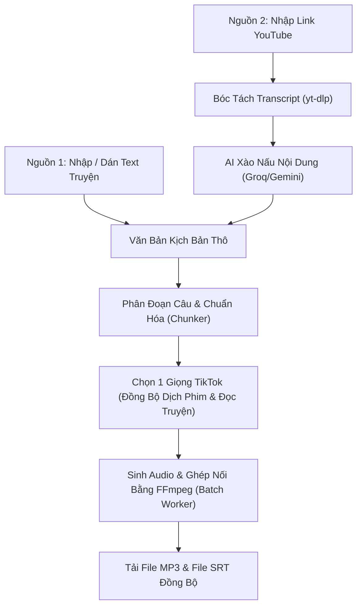

# Thiết Kế Chi Tiết: Studio Đọc Truyện & Tạo Audio (Story TTS Studio)

## 1. Mục Tiêu & Bối Cảnh
- **Tên công cụ**: **Studio Đọc Truyện & Tạo Audio (Story TTS Studio)**
- **Vị trí**: Tích hợp trực tiếp vào Trang Chủ (Home Hub) của "Siêu Tool của NgatCT", mở khóa thẻ chức năng số 4.
- **Mục tiêu**: 
  - Hỗ trợ sáng tạo nội dung đọc truyện, review, kể chuyện cho kênh YouTube / TikTok / Facebook.
  - Cho phép nhập văn bản trực tiếp HOẶC nhập link YouTube để bóc tách nội dung.
  - **Tính năng Xào Nấu AI**: Sử dụng Groq / Gemini để viết lại (rewrite / paraphrase), loại bỏ rác YouTube (chào mời, kêu gọi subscribe), chuyển đổi thành văn phong kể chuyện lôi cuốn, tránh bản quyền.
  - **Toàn bộ giọng TikTok / CapCut (Đã loại bỏ 100% giọng Microsoft)**: Khai thác trọn bộ kho giọng TikTok chất lượng cao (đặc biệt là 15+ giọng TikTok Nữ).
  - **Đồng bộ hóa toàn hệ thống**: Kho giọng TikTok này được **đồng bộ chung cho cả 2 công cụ**: Studio Dịch Phim & Lồng Tiếng (Step 4) và Studio Đọc Truyện.
  - **Xuất bản**: Xuất file Audio hoàn chỉnh (`.mp3`) và file phụ đề (`.srt`) đồng bộ.

---

## 2. Kiến Trúc Luồng Dữ Liệu (Data Flow)

---

## 3. Các Tính Năng Chi Tiết

### 3.1. Nguồn Đầu Vào & Xào Nấu AI (Input & AI Rewriter)
1. **Chế độ Nhập Trực Tiếp**: Dán text văn bản hoặc tải file `.txt`.
2. **Chế độ Lấy Từ YouTube**:
   - Nhập URL video YouTube.
   - Trích xuất nhanh phụ đề / transcript gốc (qua `yt-dlp` chỉ lấy text, không tốn băng thông tải video).
3. **Tính Năng Xào Nấu Nội Dung (AI Story Rewriter)**:
   - Sử dụng Groq (`llama-3.3-70b-versatile`) hoặc Gemini (`gemini-2.5-flash`).
   - Tùy chọn phong cách xào nấu:
     - **Kể chuyện truyền cảm**: Giữ cốt truyện, hành văn văn học, giàu cảm xúc, hợp truyện ngôn tình / tiên hiệp / đời sống.
     - **Tóm tắt kịch tính / Review**: Rút gọn các chi tiết thừa, tập trung cao trào, cuốn hút ngay từ câu mở đầu.
     - **Viết lại né bản quyền**: Paraphrase lại toàn bộ câu từ nhưng giữ nguyên thông tin cốt lõi.
   - Tự động loại bỏ các đoạn rác: *"Chào mừng các bạn đã quay trở lại kênh...", "Hãy nhấn like và đăng ký kênh..."*.

### 3.2. Kho Giọng TikTok Chuẩn Hóa (Đồng Bộ Cả Dịch Phim & Đọc Truyện)
> [!IMPORTANT]
> Đã xóa bỏ hoàn toàn 2 giọng Microsoft (`female_hoaimy`, `male_namminh`). Toàn bộ hệ thống chuyển sang sử dụng 100% giọng TikTok/CapCut.

**Nhóm Giọng TikTok Nữ (Hot TikTok, Đọc Truyện, Kể Chuyện, Review)**:
1. **Cô Gái Hoạt Ngôn** (`BV074_streaming` - Hot TikTok triệu view)
2. **Nhỏ Ngọt Ngào** (`BV421_vivn_streaming` - Nữ trẻ trung, ngọt ngào)
3. **Review Phim Mới** (`multi_female_richgirl_uranus_bigtts` - Giọng chuẩn review phim & truyện)
4. **Review Phim 2** (`multi_female_xyf04auto_uranus_bigtts`)
5. **Review Phim 3** (`multi_female_daqi_uranus_bigtts`)
6. **Review Phim 4** (`multi_female_stokie_uranus_bigtts`)
7. **Ban Mai** (`multi_female_yangguangnv_uranus_bigtts` - Trong trẻo, ấm áp)
8. **Mai** (`BV562_streaming` - Nhẹ nhàng, trầm ấm)
9. **Giọng Nữ Phổ Thông** (`vi_female_huong` - Tự nhiên)
10. **Giọng Gái Mới Lớn** (`multi_female_peiqi_uranus_bigtts` - Tươi trẻ)
11. **Bản Tin Nữ** (`multi_female_sisi_uranus_bigtts` - Rõ ràng, dứt khoát)
12. **Bản Tin 1** (`multi_female_quanweinv_uranus_bigtts`)
13. **Sunny Idol** (`multi_female_kiwi_uranus_bigtts` - Hiện đại, năng động)
14. **Giọng Bé** (`BV074_streaming_dsp` - Đáng yêu)
15. **Quên Tên Tự Test** (`multi_female_tianmeijieshuo_uranus_bigtts`)

**Nhóm Giọng TikTok Nam & Kể Chuyện (Giữ lại cho Dịch Phim & Tùy Chọn Đọc Truyện)**:
16. **Thanh Niên Tự Tin** (`BV075_streaming` - Recap Phim)
17. **Giọng Nam Trầm** (`multi_male_felipe_uranus_bigtts` - Kể Chuyện đêm muộn, trinh thám)
18. **Alex Đại Đế** (`BV560_streaming`)
19. **Kenny Đại Đế** (`BV075_streaming_demon_dsp`)
20. **Robot VN** (`BV075_streaming_robot_dsp`)

### 3.3. Phân Đoạn & Ghép Nối Âm Thanh (Audio Stitching)
- Chia văn bản theo các dấu ngắt câu tự nhiên (`.`, `?`, `!`, `...`, `\n`).
- Mỗi câu được gửi đến CapCut TTS backend (có retry tự động nếu mạng chập chờn).
- Ghép các câu thành 1 file MP3 duy nhất bằng FFmpeg, chèn khoảng nghỉ (mặc định 250-400ms giữa các câu) để âm thanh tự nhiên như người đọc thật.
- Tính toán chính xác thời gian bắt đầu và kết thúc của từng câu để sinh file `.srt` chuẩn xác 100%.

### 3.4. Xuất Bản Phẩm (Export Hub)
- **Tải Audio (`.mp3`)**: File âm thanh chất lượng cao, nghe liền mạch.
- **Tải Phụ Đề (`.srt`)**: Đồng bộ khớp thời gian để đưa vào CapCut / Premiere.
- Có trình phát Audio Player tích hợp ngay trên màn hình để nghe kiểm tra trước khi tải.

---

## 4. Tệp Cần Chỉnh Sửa & Bổ Sung
1. **`app/capcut_tts.py`**: Khai báo bổ sung toàn bộ danh mục giọng TikTok từ `Voice.json`.
2. **`app/tts.py`**: Gỡ bỏ 2 giọng Microsoft Edge-TTS (`female_hoaimy`, `male_namminh`), cập nhật `VOICE_PRESETS` chỉ chứa 100% giọng TikTok.
3. **`app/story_tts.py`** *(Mới)*: Module backend xử lý:
   - Lấy phụ đề/transcript từ URL YouTube bằng `yt-dlp`.
   - Prompt xào nấu kịch bản bằng Groq / Gemini.
   - Tách câu, batch TTS từng câu, ghép audio MP3 kèm khoảng lặng, và tạo file SRT.
4. **`app/main.py`**: 
   - Đồng bộ endpoint `/api/voices` trả về danh sách giọng TikTok mới.
   - Đăng ký các API endpoints cho Story TTS.
5. **`app/static/index.html`**: 
   - Cập nhật cả 2 dropdown giọng đọc (ở Dịch phim bước 4 và thanh công cụ dùng chung) để xóa giọng Edge-TTS và hiển thị danh sách giọng TikTok mới.
   - Mở khóa Thẻ số 4 trên Home Hub, thêm tab điều hướng trên Header, thêm section `#story-tts-view`.
6. **`app/static/style.css`**: Style cho giao diện Studio Đọc Truyện (hộp lấy link YouTube, nút xào nấu AI, danh sách giọng TikTok nữ, player nghe thử).
7. **`app/static/app.js`**: Logic điều hướng hash `#story-tts`, gọi API trích xuất YouTube, gọi AI xào nấu, render text, kích hoạt tạo audio MP3 và tải về.
